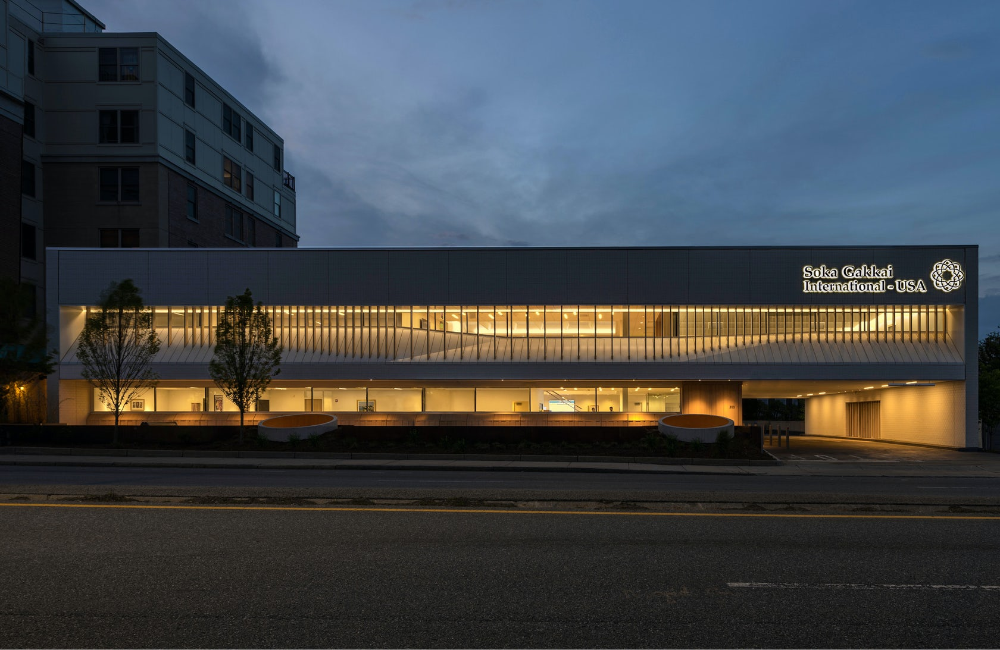
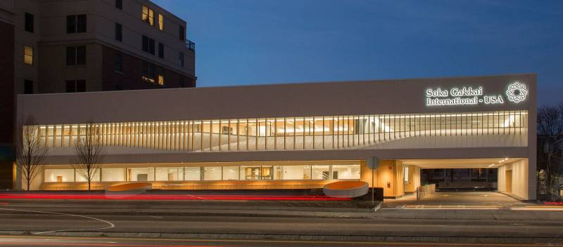
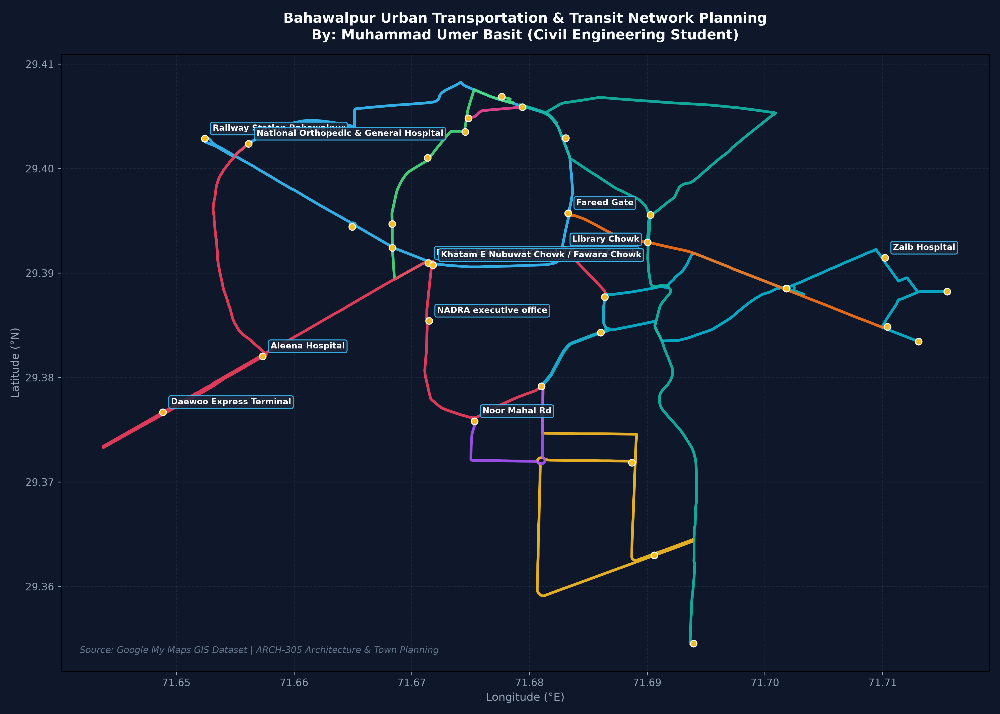

# 🏛️ Architecture & Town Planning: Modern Public Library Design & Bahawalpur Urban Transit Framework



[](https://www.autodesk.com/products/autocad)
[](https://www.google.com/maps/d/u/0/edit?hl=en&mid=1oMlt49UhS-NYLDzG9Fp5pk6mVF-oYtBx&ll=29.384851658433774%2C71.68193195000002&z=14)
[](#)
[](#)
[](LICENSE)

---

## 📌 Executive Summary

This repository presents the architectural design, exterior facade articulation, and urban transportation planning portfolio developed by **Muhammad Umer Basit** (Civil Engineering Student) for the **ARCH-305: Architecture and Town Planning** curriculum.

The project pairs two foundational urban components:
1. **Architectural Building Design**: Spatial planning, passive solar design, and modern facade articulation for a **Contemporary Public / Campus Library Facility** in AutoCAD (`.dwg`) and vector print sheets (`.pdf`).
2. **Urban Transportation & GIS Network Planning**: A comprehensive GIS transit planning project analyzing **Bahawalpur's Main Transportation Routes & Urban Mobility Corridors**, documented through Google My Maps, KML spatial datasets, and automated Python cartographic visualization.

---

## 📚 Architectural Program: Modern Public Library



### 1. Functional Zoning & Space Planning
A contemporary library balances quiet literature study with collaborative community engagement:
- **Central Atrium & Orientation Foyer**: Multi-height entrance lobby providing clear sightlines, automated book return modules, and reception.
- **Quiet Reading Halls & Individual Carrels**: Positioned along shaded elevations to harness diffuse northern natural daylighting while avoiding direct solar glare.
- **High-Density Stacks (Book Storage)**: Centralized floor plate loading with heavy dead-load capacity.
- **Digital Research & Multimedia Lab**: Flexible power distribution and IT network routing for digital catalogs and student workstations.
- **Administrative & Archive Wings**: Processing rooms, restoration facilities, administrative suites, and staff amenities.

### 2. Facade Articulation & Passive Climate Strategy
- **Solar Shading & Vertical Louvers**: Architectural fins designed to mitigate solar heat gain while preserving exterior sightlines.
- **Double-Glazed Curtain Wall**: Acoustic and thermal insulation protecting quiet study zones from exterior urban traffic noise.
- **Grand Entrance Canopy**: Distinct volumetric portal giving the building an inviting civic presence.

---

## 🗺️ Bahawalpur Urban Transportation & Transit Network Planning



> 🌐 **Interactive Map**: Explore the live GIS network on [Google My Maps](https://www.google.com/maps/d/u/0/edit?hl=en&mid=1oMlt49UhS-NYLDzG9Fp5pk6mVF-oYtBx&ll=29.384851658433774%2C71.68193195000002&z=14).

### Key Transportation Corridors Mapped by Muhammad Umer Basit:
1. **Railway Station & Core Urban Spine**: Transit loop connecting Bahawalpur Railway Station, Muhajir Colony, Saraiki Chowk, and Fawara Chowk / Khatam-e-Nubuwat Chowk.
2. **Inter-City Transit Corridor**: Bus terminal route linking Azizabad Colony, Multani Gate (Old City), and Chika Wala Chowk.
3. **Healthcare & Inter-Regional Hub**: Connecting the National Orthopedic & General Hospital through Kausar Colony and Daewoo Express Terminal to Library Chowk.
4. **Cantonment & Civic Recreation**: Pelikan Chowk, Deer Reserve Park, and Quaid-e-Azam Avenue.
5. **Historical & Tourism Corridor**: Pelikan Chowk to the historic Noor Mahal Palace Road.
6. **Old City Transit & Speedo Feeder**: Connecting Multani Gate, Doctor Raja Road, and the General Transport Service Road.
7. **Educational Belt Corridor**: Connecting Rangers Public School, Government College of Technology (Hasilpur Road), and University Road (Satellite Town).
8. **Historic Commercial Core Link**: Route from Government College of Technology to the historic Fareed Gate.
9. **Administrative & Commercial Axis**: University Chowk, DC Chowk, and Airport Road (Garden Town).

---

## 📂 Repository File Structure

```text
Architecture-Town-Planning-Library-Design/
│
├── README.md                                  # Project overview and documentation
├── LICENSE                                    # MIT License
├── .gitignore                                 # Ignores CAD lockfiles and temporary files
│
├── drawings/
│   ├── cad/                                   # Native Autodesk AutoCAD drawings
│   │   ├── final-library-design.dwg           # Master architectural CAD drawing
│   │   ├── updated-library-plan.dwg           # Refined spatial layout
│   │   └── facade-library-design.dwg          # Exterior facade elevation details
│   │
│   └── pdf-sheets/                            # Universal vector PDF sheets for in-browser preview
│       ├── Final-Library-Architectural-Sheet.pdf
│       ├── Library-Facade-and-Layout-1.pdf
│       └── Library-Facade-and-Layout-2.pdf
│
├── gis/                                       # GIS Datasets
│   └── bahawalpur_transportation_planning.kml # Complete Google My Maps KML export
│
├── scripts/                                   # Python GIS Visualization
│   └── generate_gis_map.py                    # Script parsing KML and rendering transit map
│
├── assignments/                               # Coursework assignments by Muhammad Umer Basit
│   ├── ATP-Assignment-01-by-Muhammad-Umer-Basit.pdf
│   ├── ATP-Assignment-02-by-Muhammad-Umer-Basit.pdf
│   ├── ATP-Assignment-03-by-Muhammad-Umer-Basit.pdf
│   └── Muhammad-Umer-Basit-Assignment-ATP-Final.pdf
│
├── lectures-and-curriculum/                   # Full ARCH-305 course curriculum & lectures
│   ├── ARCH-305_COURSE_OUTLINE.pdf
│   ├── Lecture-1-Introduction_town_planning_upload.pdf
│   ├── Lecture-2-The-Planning-Proccess-and-its-Socioeco-Aspects.pdf
│   ├── Lecture-3-Planning_Approaches.pdf
│   ├── Lecture-4-Urban-Form.pdf
│   ├── Lecture-5-Urban-Form-and-Transport.pdf
│   ├── Lecture-6-Landuse-MODELS-I.pdf
│   ├── Lecture-6-Landuse-Models-II.pdf
│   ├── Lecture-7-Zoning-and-neighhourhood-design.pdf
│   ├── Lecture-8-Street-Patterns.pdf
│   ├── Lecture-9-GIS_Urban_Planning.pdf
│   ├── Lecture-10-Urban-Renewal.pdf
│   ├── Lecture-11-Architecture-PRIMARY-ELEMENTS.pdf
│   ├── Lecture-12-Comparison_ancient_Civilization.pdf
│   ├── Lecture-13-Ancient-Architecture.pdf
│   ├── Lecture-14-History-of-Architecture.pdf
│   ├── Lecture-15-IslamicArchitecture.pdf
│   └── W5LEC5-Pre-historic-Architecture.pdf
│
└── media/                                     # High-resolution architectural renders & figures
    ├── hero-library-render.jpg
    ├── library-elevation-preview.jpg
    └── bahawalpur-urban-transit-map.png
```

---

## 🛠️ Viewing & Editing Instructions

- **Viewing `.dwg` files**:
  - Full Editing: **Autodesk AutoCAD 2021 or newer**.
  - Browser Viewing: [Autodesk Viewer (Free online)](https://viewer.autodesk.com/) or **Autodesk DWG TrueView**.
- **Viewing `.pdf` sheets**:
  - Open directly in any web browser or through GitHub's native PDF previewer.
- **Viewing GIS KML**:
  - Open in **Google Earth**, **QGIS**, or import directly into **Google My Maps**.

---

## 👤 Author & Academic Attribution

- **Student / Author:** [Muhammad Umer Basit](https://github.com/MuhammadUmerBasit)  
  *Civil Engineering Student*
- **Course:** ARCH-305 Architecture and Town Planning, Semester 7

---

## 📄 License

This repository is licensed under the [MIT License](LICENSE).
