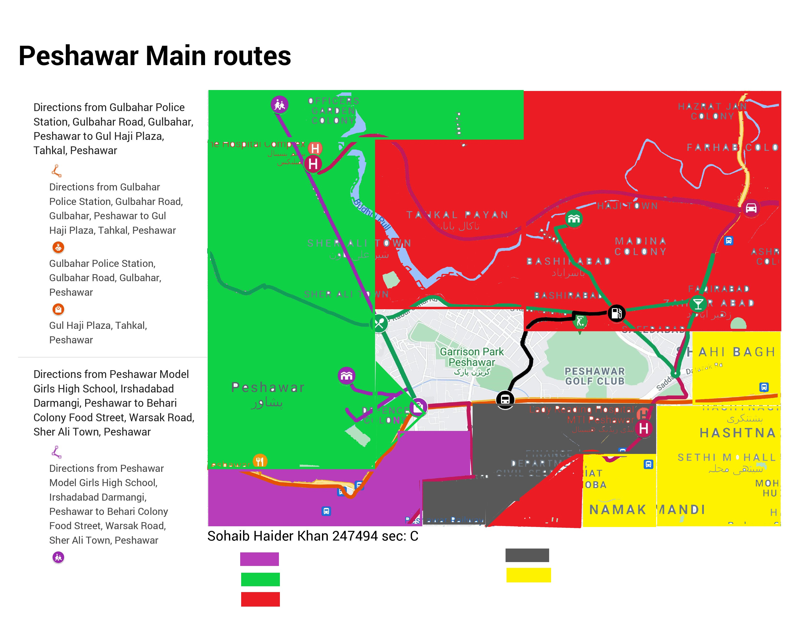

# 🏛️ Architecture & Town Planning: Modern Public Library Design & Urban Framework


[](https://www.autodesk.com/products/autocad)
[](#)
[](#)
[](#)
[](LICENSE)

---

## 📌 Executive Summary

This repository presents the architectural design, exterior facade articulation, and urban town planning portfolio developed for the **ARCH-305: Architecture and Town Planning** curriculum during Semester 7.

The capstone architectural project showcases the spatial layout, modern facade treatment, and functional zoning for a **Contemporary Public / Campus Library Facility**. The project incorporates:
- **Computer-Aided Drafting (CAD)**: Vector floor plans, cross-sections, and facade elevations provided in both native Autodesk AutoCAD (`.dwg`) format and publication vector sheets (`.pdf`).
- **Urban Town Planning Research**: Comprehensive urban studies on city growth models, zoning bye-laws, street hierarchies, land-use surveys, and Geographic Information Systems (GIS) application.
- **Academic Coursework**: Original project assignments by **Muhammad Umer Basit** (Student ID: `259084`, Section C) along with the complete 17-module course curriculum.

---

## 📚 Architectural Program: Modern Public Library


### 1. Functional Zoning & Space Planning
A contemporary library must balance the quiet preservation of physical literature with collaborative public interaction:
- **Central Atrium & Circulation Hub**: Open multi-height foyer with reception desk, automated book return modules, and immediate orientation sightlines.
- **Quiet Reading Halls & Individual Carrels**: Positioned along shaded elevations to maximize diffuse northern natural daylight while eliminating direct glare on reading desks.
- **High-Density Stacks (Book Storage)**: Centralized floor plate loading with floor slabs dimensioned to handle heavy archive dead loads.
- **Digital Research & Multimedia Lab**: Flexible power and IT networking infrastructure for electronic cataloguing and student workstations.
- **Administrative Offices & Meeting Rooms**: Dedicated processing rooms, cataloguing offices, archive restoration, and staff break amenities.

### 2. Facade Articulation & Passive Climate Strategy
- **Solar Shading & Vertical Louvers**: Exterior architectural fins engineered to mitigate intense solar heat gain while maintaining daylight penetration into study spaces.
- **Double-Glazed Curtain Wall**: Insulated glass envelope reducing exterior acoustic transmission and maintaining indoor climate comfort.
- **Grand Entrance Portal**: Distinct volumetric architectural framing establishing a recognizable public civic identity.

---

## 🌆 Town Planning & Urban Design Framework

In addition to the standalone library design, this portfolio documents core urban planning principles:



### 1. Urban Land-Use Models & Growth Morphology
- **Concentric Zone Model (Burgess)**: Radial urban expansion and Central Business District (CBD) transition zones.
- **Sector Model (Hoyt)**: Transportation-corridor-driven industrial and residential wedge development.
- **Multiple Nuclei Model (Harris & Ullman)**: Decentralized polycentric urban agglomerations.

### 2. Zoning Regulations & Building Bye-Laws
- **Setback Distances**: Front, rear, and side setback requirements ensuring fire buffer zones, cross-ventilation, and natural light penetration.
- **Floor Area Ratio (FAR) & Ground Coverage**: Density control metrics balancing built-up footprint against public green space.
- **Parking Standards**: Mandatory off-street vehicular bay allocations based on gross floor area and occupant load.

### 3. Street Hierarchies & Circulation
- Classification of urban thoroughfares from primary arterials and secondary collectors to local residential access streets and dedicated pedestrian networks.
- Cul-de-sac and gridiron geometry analysis for traffic calming and emergency egress.

### 4. GIS in Urban Planning
- Application of spatial multi-criteria evaluation (MCE), parcel boundary mapping, buffer analysis, and demographic density projection.

---

## 📂 Repository File Structure

```text
Architecture-Town-Planning-Library-Design/
│
├── README.md                                  # Project overview and documentation
├── LICENSE                                    # MIT License
├── .gitignore                                 # Ignores CAD lockfiles and temporary files
│
├── drawings/
│   ├── cad/                                   # Native Autodesk AutoCAD drawings
│   │   ├── final-library-design.dwg           # Master architectural CAD drawing
│   │   ├── updated-library-plan.dwg           # Refined spatial layout
│   │   └── facade-library-design.dwg          # Exterior facade elevation details
│   │
│   └── pdf-sheets/                            # Universal vector PDF sheets for in-browser preview
│       ├── Final-Library-Architectural-Sheet.pdf
│       ├── Library-Facade-and-Layout-1.pdf
│       └── Library-Facade-and-Layout-2.pdf
│
├── assignments/                               # Coursework assignments by Muhammad Umer Basit
│   ├── ATP-Assignment-01-by-Muhammad-Umer-Basit-Regn-No-259084-SectionC.pdf
│   ├── ATP-Assignment-by-Muhammad-Umer-Basit-259084-Section-C.pdf
│   └── Muhammad-Umer-Basit-259084-Assignment-ATP-final.pdf
│
├── lectures-and-curriculum/                   # Full ARCH-305 course curriculum & lectures
│   ├── ARCH-305_COURSE_OUTLINE.pdf
│   ├── Lecture-1-Introduction_town_planning_upload.pdf
│   ├── Lecture-2-The-Planning-Proccess-and-its-Socioeco-Aspects.pdf
│   ├── Lecture-3-Planning_Approaches.pdf
│   ├── Lecture-4-Urban-Form.pdf
│   ├── Lecture-5-Urban-Form-and-Transport.pdf
│   ├── Lecture-6-Landuse-MODELS-I.pdf
│   ├── Lecture-6-Landuse-Models-II.pdf
│   ├── Lecture-7-Zoning-and-neighhourhood-design.pdf
│   ├── Lecture-8-Street-Patterns.pdf
│   ├── Lecture-9-GIS_Urban_Planning.pdf
│   ├── Lecture-10-Urban-Renewal.pdf
│   ├── Lecture-11-Architecture-PRIMARY-ELEMENTS.pdf
│   ├── Lecture-12-Comparison_ancient_Civilization.pdf
│   ├── Lecture-13-Ancient-Architecture.pdf
│   ├── Lecture-14-History-of-Architecture.pdf
│   ├── Lecture-15-IslamicArchitecture.pdf
│   └── W5LEC5-Pre-historic-Architecture.pdf
│
└── media/                                     # High-resolution architectural renders & figures
    ├── hero-library-render.jpg
    ├── library-elevation-preview.jpg
    └── urban-planning-study.jpg
```

---

## 🛠️ Viewing & Editing Instructions

- **Viewing `.dwg` files**:
  - Full Editing: **Autodesk AutoCAD 2021 or newer**.
  - Browser Viewing: [Autodesk Viewer (Free online viewer)](https://viewer.autodesk.com/) or **Autodesk DWG TrueView**.
- **Viewing `.pdf` sheets**:
  - Open directly in any web browser or through GitHub's native PDF previewer.

---

## 👤 Author & Academic Attribution

- **Architectural Designer & Student:** [Muhammad Umer Basit](https://github.com/MuhammadUmerBasit)  
  *Registration No: 259084, Section C*
- **Course:** ARCH-305 Architecture and Town Planning, Semester 7

---

## 📄 License

This repository is licensed under the [MIT License](LICENSE).
